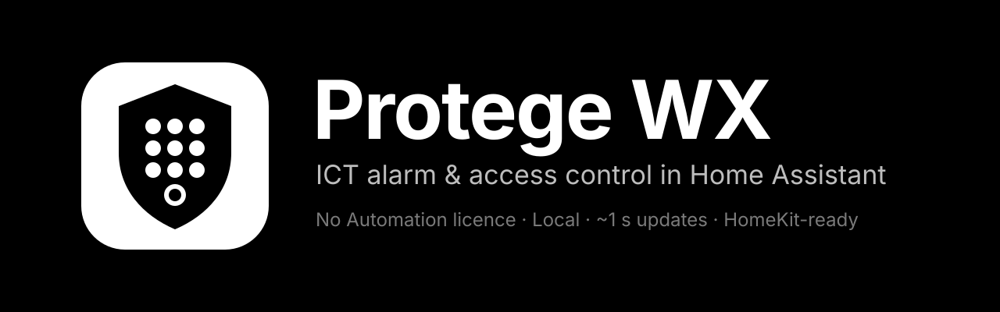
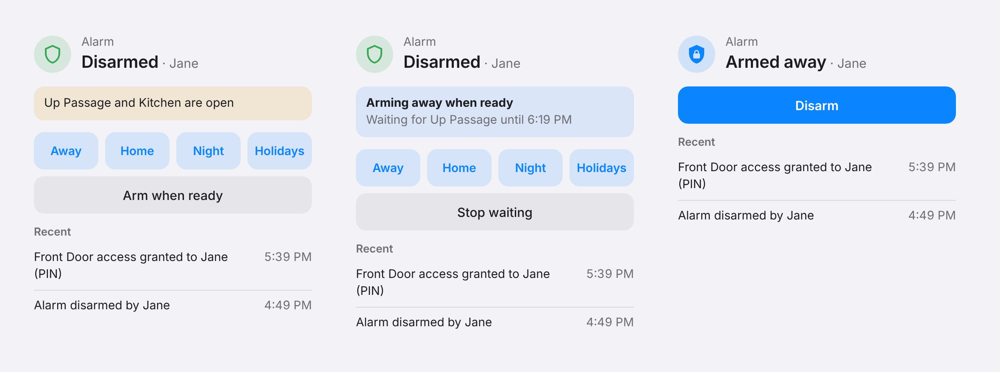

  

  
  
  
  
  

  <b>Arm, disarm, unlock and watch your ICT Protege WX from Home Assistant and Apple Home.</b> 
  Through the controller's own web interface, so <b>no Automation &amp; Integration licence is needed.</b>

  
  &nbsp;
  

  <a href="https://github.com/olliemaller/ha-protege-wx/blob/main/docs/Installation.md">Install</a> ·
  <a href="https://github.com/olliemaller/ha-protege-wx/blob/main/docs/Setup.md">Set up</a> ·
  <a href="https://github.com/olliemaller/ha-protege-wx/blob/main/docs/Features.md">Features</a> ·
  <a href="https://github.com/olliemaller/ha-protege-wx/blob/main/docs/Automations.md">Automations</a> ·
  <a href="https://github.com/olliemaller/ha-protege-wx/blob/main/docs/Troubleshooting.md">Troubleshooting</a> ·
  <a href="https://github.com/olliemaller/ha-protege-wx/blob/main/docs/README.md">All docs</a>

---

<picture>
  <source media="(prefers-color-scheme: dark)" srcset="https://raw.githubusercontent.com/olliemaller/ha-protege-wx/main/images/alarm-card-dark.png">
  
</picture>

> [!IMPORTANT]
> **Unofficial.** Not affiliated with or endorsed by Integrated Control Technology. "ICT" and "Protege" are trademarks of their owner, used here only to describe compatibility.

> [!WARNING]
> **It controls a live security system.** Use a dedicated operator with only the permissions Home Assistant needs, and test arming, disarming and door control while you're on site.

## What you get

| | |
|---|---|
| **Alarm panel** | Away, Home, Night and Holidays, with the right modes in Apple Home, even during the exit delay. |
| **[Alarm card](https://github.com/olliemaller/ha-protege-wx/blob/main/docs/Alarm-card.md)** | Countdown, open zones, what set it off, a PIN keypad and recent activity. Follows your theme, light or dark. Ships with the integration. |
| **[Arm when ready](https://github.com/olliemaller/ha-protege-wx/blob/main/docs/Arm-when-ready.md)** | Arms the moment the last window shuts, or gives up after 30 minutes. |
| **[Automations](https://github.com/olliemaller/ha-protege-wx/blob/main/docs/Automations.md)** | "Access granted", "Door forced or left open", "Area failed to arm" and emergency triggers, plus an "Area is ready to arm" condition. |
| **Doors** | Timed unlock, hold open, visitor unlock, forced and left-open sensors, and who came in last. |
| **Who did it** | The keypad user, card, PIN or Home Assistant user behind every arm, disarm and door. |
| **[Voice](https://github.com/olliemaller/ha-protege-wx/blob/main/docs/Voice.md)** | "Is the house armed?", "Can I arm?", "Who came in last?" |
| **Health** | Trouble inputs, an "Alarm fault" sensor, supply voltage and Repairs alerts. |
| **Fast and local** | Updates about every second, straight from your controller. No cloud. |

Also: [Apple Home, wall tablets and Alarmo sync](https://github.com/olliemaller/ha-protege-wx/blob/main/docs/Apple-Home-and-Alarmo.md), [actions](https://github.com/olliemaller/ha-protege-wx/blob/main/docs/Actions.md), and [how it looks after your controller](https://github.com/olliemaller/ha-protege-wx/blob/main/docs/How-it-protects-your-controller.md).

## Quick start

1. **Install** from the Marketplace (Home Assistant 2026.11+) or HACS with the button above. [Other ways](https://github.com/olliemaller/ha-protege-wx/blob/main/docs/Installation.md).
2. **Create an operator** for Home Assistant in the Protege web interface, with a 15-minute session timeout. [Details](https://github.com/olliemaller/ha-protege-wx/blob/main/docs/Setup.md).
3. **Add the integration** with the web interface address (for example `192.168.1.10:7377`) and the operator's login.
4. **Add the card**: search for **Protege WX alarm** in the dashboard editor.

Needs a Protege WX with its web interface turned on and Home Assistant 2025.1 or newer. Tested on web interface 2.3.x; older versions are supported. Please [tell us how it went](https://github.com/olliemaller/ha-protege-wx/issues/new/choose) on yours.

## Help and contributing

- Something not working? See [Troubleshooting](https://github.com/olliemaller/ha-protege-wx/blob/main/docs/Troubleshooting.md), then [open an issue](https://github.com/olliemaller/ha-protege-wx/issues/new/choose).
- Found a security problem? Report it privately; see the [security policy](https://github.com/olliemaller/ha-protege-wx/blob/main/SECURITY.md).
- Want to help? Read [CONTRIBUTING](https://github.com/olliemaller/ha-protege-wx/blob/main/CONTRIBUTING.md) and the [code of conduct](https://github.com/olliemaller/ha-protege-wx/blob/main/CODE_OF_CONDUCT.md).

Protocol work builds on [protege-wx-cli](https://github.com/mitchell-johnson/protege-wx-cli) by Mitchell Johnson. [More credits](https://github.com/olliemaller/ha-protege-wx/blob/main/docs/Development.md#credits).

## Licence

[MIT](https://github.com/olliemaller/ha-protege-wx/blob/main/LICENSE). See also [NOTICE](https://github.com/olliemaller/ha-protege-wx/blob/main/NOTICE).
