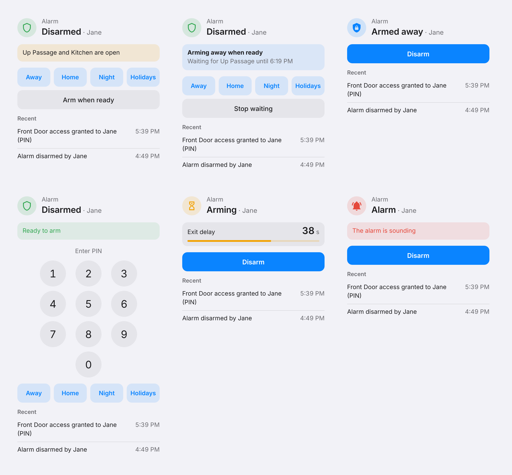

# Alarm card

The integration adds a dashboard card. There's nothing to download or add to resources. It takes its font and colours from your Home Assistant theme, light or dark.

<picture>
  <source media="(prefers-color-scheme: dark)" srcset="https://raw.githubusercontent.com/olliemaller/ha-protege-wx/main/images/card-states-dark.png">
  
</picture>

## Add it

Add a card, search for **Protege WX alarm**, and pick the area. Every option is in the visual editor. In YAML:

```yaml
type: custom:protege-alarm-card
entity: alarm_control_panel.alarm
# optional
name: House
show_keypad: true          # when a PIN is needed
show_arm_when_ready: true  # "Arm when ready" while zones are open
show_activity: true        # recent arming, disarming and doors
activity_count: 5
```

## What it shows

| Part | What it does |
|---|---|
| **Header** | The area's state and who changed it last. The badge colour follows the state. |
| **Status line** | One line at a time: what set the alarm off, the exit or entry countdown, what Arm when ready is waiting for, which zones are open, or "Ready to arm". |
| **Modes** | Away, Home, Night and Holidays, only the ones the area allows. When armed, a single Disarm button. |
| **Arm when ready** | Shown while zones are open. Asks for the PIN first when arming needs one. Changes to **Stop waiting** while it waits. |
| **Keypad** | Shown when a PIN is needed. |
| **Recent** | The last few arming, disarming and door events from the logbook. |

It finds the area's open-zones, delay, alarm-cause and arm-when-ready entities by itself.

## If it shows "Configuration error"

Update to 0.3.1 or later, restart Home Assistant, then refresh the browser or app (in the Companion app: **Settings > Reset frontend cache**).
